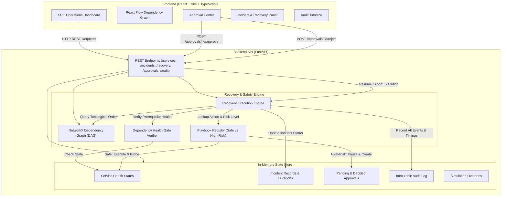

# BRIDGE

### Backend Recovery & Intelligent Dependency Governance Engine
> **“Detect. Recover. Verify.”**

**BRIDGE** is a dependency-aware incident recovery platform that detects service failures, analyzes upstream dependencies, coordinates controlled recovery workflows, verifies service health, and maintains an auditable record of recovery operations. In complex distributed systems, naive recovery—such as restarting all failing components simultaneously—frequently leads to thundering herds, cascade failures, and race conditions. 

BRIDGE models service architectures as directed acyclic graphs (DAGs), detects simulated outages, determines transitive downstream impact, calculates strict topological recovery sequences, enforces dependency health gates, and halts high-risk operations until explicit human authorization is granted.

---

## The Problem

When a critical upstream component fails (for example, a database primary), all downstream services (APIs, worker pools, web frontends) degrade or crash in cascade. 

Common recovery pitfalls in manual incident response include:
1. **Out-of-Order Restarts:** Attempting to restart an API or worker before the database is fully online and accepting connections, causing crash loops and pool exhaustion.
2. **Unchecked High-Risk Operations:** Executing destructive actions (such as restoring database snapshots) without human verification and audit logging.
3. **Lack of Dependency Verification:** Assuming a service is healthy without checking if its prerequisite upstream dependencies passed their health probes first.
4. **Poor Auditability:** Missing structured records of who approved what action, which probes ran, and how long recovery took.

BRIDGE eliminates these failure modes by orchestrating recovery sequentially in dependency order with automated prerequisite verification gates and safety approvals.

---

## Key Features

- **Dependency Graph & Downstream Impact Analysis:** Models services and dependencies using NetworkX. Outages automatically mark the root service as `failed` and cascade `degraded` states to all downstream dependents.
- **Topological Recovery Sequencing:** Computes the exact dependency-safe recovery order using topological sorting, guaranteeing root dependencies are restored before dependent services.
- **Sequential Recovery & Health Gates:** Before executing recovery on any service, the engine validates that all direct upstream prerequisites are `healthy`. If a prerequisite is down, dependent recovery halts immediately.
- **Human-in-the-Loop Approval Gates:** Classifies recovery playbooks by risk. Safe actions (such as container restarts or cache clears) execute automatically; high-risk actions (such as database backup restores) pause execution until an operator explicitly approves or rejects them in the backend.
- **Safe Rejection & Abort Handling:** If an operator rejects a high-risk action, recovery aborts safely, services remain protected in degraded state, and the abort reason is logged.
- **Incident Timing & Audit Trail:** Records an immutable, timestamped event log for every state transition, dependency check, approval request, approval decision, simulated action, and health check, alongside total recovery duration metrics.
- **Interactive React Flow Dashboard:** Provides an SRE operations interface with live graph visualization, incident inspection, plan previews, approval actions, and audit logs.

---

## Architecture

BRIDGE is structured as a decoupled full-stack application:

- **Frontend:** React 18, TypeScript, Vite, Tailwind CSS, and `@xyflow/react` (React Flow) for DAG visualization.
- **Backend:** Python 3.14 / FastAPI REST API with CORS support.
- **Graph Engine:** NetworkX directed graph (`nx.DiGraph`) for topological sorting, cycle detection, and prerequisite resolution.
- **Execution & Playbook Engine:** Sequential step runner, risk evaluator, and health check verifier.
- **State Store:** In-memory state management for service statuses, incident records, approval queues, audit trails, and test overrides.



---

## Service Dependency Model

The system simulates five core microservices with the following directed dependencies (where $A \rightarrow B$ denotes **$B$ depends on $A$**):

```
       ┌──────────┐
       │ database │
       └────┬─────┘
            │
            ▼
     ┌─────────────┐
     │ backend_api │
     └──────┬──────┘
            │
      ┌─────┴────────┐
      ▼              ▼
┌──────────────┐   ┌─────────────────┐
│ order_service│   │ payment_service │
└─────┬────────┘   └────────┬────────┘
      │                     │
      └──────────┬──────────┘
                 ▼
            ┌─────────┐
            │ website │
            └─────────┘
```

| Service Name | Direct Prerequisites | Playbook Action | Risk Classification | Health Check Probe |
|---|---|---|---|---|
| `database` | *(None — Root)* | `restore_backup_and_restart` | `high_risk` | `database_ping_and_replication_check` |
| `backend_api` | `database` | `restart_service` | `safe` | `http_health_endpoint` |
| `order_service` | `backend_api` | `restart_service` | `safe` | `worker_heartbeat_and_queue_probe` |
| `payment_service` | `backend_api` | `restart_service` | `safe` | `gateway_handshake_probe` |
| `website` | `order_service`, `payment_service` | `clear_cache_and_restart` | `safe` | `synthetic_ui_probe` |

---

## Installation & Setup

### Prerequisites
- Python 3.10+ (tested on Python 3.14)
- Node.js 18+ & npm (tested on Node v24 / npm 11)

### 1. Backend Setup (PowerShell)

From the project root:

```powershell
# Create and activate virtual environment (optional but recommended)
python -m venv .venv
.\.venv\Scripts\Activate.ps1

# Install backend dependencies
pip install -r requirements.txt

# Start the FastAPI server
uvicorn app.main:app --reload --port 8000
```

The API will be available at `http://localhost:8000` (Swagger documentation at `http://localhost:8000/docs`).

### 2. Frontend Setup (PowerShell)

In a separate terminal window:

```powershell
# Navigate to the frontend directory
cd frontend

# Install dependencies
npm install

# Start the development server
npm run dev
```

Open `http://localhost:5173` in your browser.

---

## REST API Reference

All routes are implemented in [`app/main.py`](file:///c:/Users/Akshita/Documents/GitHub/agnitia/app/main.py):

| Method | Endpoint | Description |
|---|---|---|
| `GET` | `/` | Basic service health check |
| `GET` | `/services` | List current status of all services (`healthy`, `degraded`, `failed`, `recovering`) |
| `GET` | `/dependencies` | Return dependency graph nodes and directed edges |
| `POST` | `/simulate/fail/{service_name}` | Simulate an outage in a service and cascade degradation to dependents |
| `GET` | `/incidents` | List all recorded incident histories and metrics |
| `GET` | `/incidents/{incident_id}` | Retrieve detailed incident data, recovery steps, and audit logs |
| `GET` | `/recovery/plan/{service_name}` | Compute topological recovery sequence for a failed service |
| `POST` | `/recovery/start/{incident_id}` | Initiate sequential recovery execution for an incident |
| `GET` | `/approvals` | List all approvals (optional query filter: `?status=pending|approved|rejected`) |
| `GET` | `/approvals/pending` | List pending high-risk approvals waiting on operator decision |
| `POST` | `/approvals/{approval_id}/approve` | Approve a pending action and resume recovery execution |
| `POST` | `/approvals/{approval_id}/reject` | Reject a pending action and abort recovery execution |
| `GET` | `/audit` | Query immutable audit log (optional query filter: `?incident_id=...`) |
| `POST` | `/simulate/configure` | Configure simulation behavior overrides (e.g. inject action/probe failures) |

---

## Step-by-Step Demo Scenario

You can run this demo end-to-end using the Web Dashboard or via `curl` / PowerShell:

### Step 1: Inject Outage
1. In the **Incident Simulation** panel, select `database` and click **Simulate Failure** (or `POST /simulate/fail/database`).
2. **Observe:** The `database` node turns red (`failed`). Downstream dependents (`backend_api`, `order_service`, `payment_service`, `website`) turn yellow (`degraded`). An incident is created with status `open`.

### Step 2: Preview the Recovery Plan
1. Click **Preview Plan** for `database` (or `GET /recovery/plan/database`).
2. **Observe:** The calculated sequential order is displayed:
   `database` $\rightarrow$ `backend_api` $\rightarrow$ `order_service` / `payment_service` $\rightarrow$ `website`.

### Step 3: Start Recovery
1. In the **Incident Panel**, click **Execute Recovery Plan** (or `POST /recovery/start/{incident_id}`).
2. **Observe:** The recovery starts. Step 1 targets `database` (`restore_backup_and_restart`). Because this action is classified as `high_risk`, recovery pauses immediately with status `awaiting_approval`.

### Step 4: Review and Approve High-Risk Action
1. Look at the **Human Approval Center** card. A pending approval appears for `database`.
2. Enter an optional reason (e.g., *"Snapshot integrity verified"*) and click **Approve & Resume Recovery** (or `POST /approvals/{approval_id}/approve`).

### Step 5: Sequential Execution & Health Gate Verification
1. The engine resumes:
   - **Step 1 (`database`):** Executes backup restore $\rightarrow$ runs health check $\rightarrow$ transitions to `healthy`.
   - **Step 2 (`backend_api`):** Verifies `database` prerequisite is `healthy` $\rightarrow$ executes safe restart $\rightarrow$ passes probe $\rightarrow$ transitions to `healthy`.
   - **Step 3 & 4 (`order_service`, `payment_service`):** Verify `backend_api` is `healthy` $\rightarrow$ execute safe restarts $\rightarrow$ transition to `healthy`.
   - **Step 5 (`website`):** Verifies both `order_service` and `payment_service` are `healthy` $\rightarrow$ clears cache & restarts $\rightarrow$ transitions to `healthy`.
2. **Observe:** Incident status transitions to `resolved`. Total recovery duration is calculated and recorded.

### Step 6: Inspect Audit Trail
1. In the **Immutable Audit Trail** panel, inspect the chronological events:
   - `incident_created`
   - `recovery_started`
   - `approval_requested`
   - `approval_approved`
   - `dependency_check_passed` (per service)
   - `recovery_action_executed` (per service)
   - `health_check` (per service)
   - `recovery_completed`

---

## Testing

The automated test suite verifies graph properties, cycle detection, recovery ordering, API routes, recovery engine execution, dependency gates, approval gates, failure simulations, real TCP process supervisor recovery, and timing calculations.

### Run Test Suite
```powershell
python -m pytest tests/ -v
```

### Verified Test Results
The backend test suite contains **90 comprehensive tests**, all reported passing:

```text
======================== 90 passed, 1 warning in 8.57s ========================
```

---

## Tech Stack

| Layer | Technologies |
|---|---|
| **Frontend** | React 18, TypeScript, Vite 6, Tailwind CSS 3, `@xyflow/react` (React Flow), Lucide React |
| **Backend** | Python 3.14, FastAPI, Uvicorn, Pydantic |
| **Process Supervisor** | Pure Python `subprocess.Popen` (safe fixed path, `shell=False`, PID lifecycle) |
| **Graph Modeling** | NetworkX |
| **Testing** | Pytest, Starlette / HTTPX TestClient |

---

## Capabilities & Scope

- **Real Python OS Process Recovery:** Dedicated process supervisor (`app/supervisor.py`) managing an independent child process (`standalone_service/server.py`), real TCP HTTP health/products probing, fault injection, and restart recovery with zero external infrastructure dependencies.
- **Simulated Multi-Tier Graph Recovery:** Graph dependency models, transitive cascading failures, and mockable simulation overrides for multi-tier chaos drills.
- **In-Memory State Store:** Service states, incidents, approvals, and audit logs are stored with thread-safe synchronizations.
- **Synchronous Execution:** Recovery sequence steps execute deterministically within the API request lifecycle.


